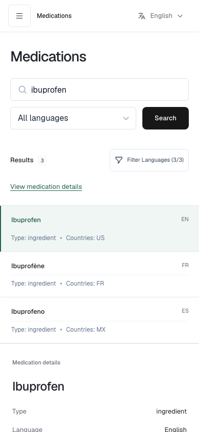
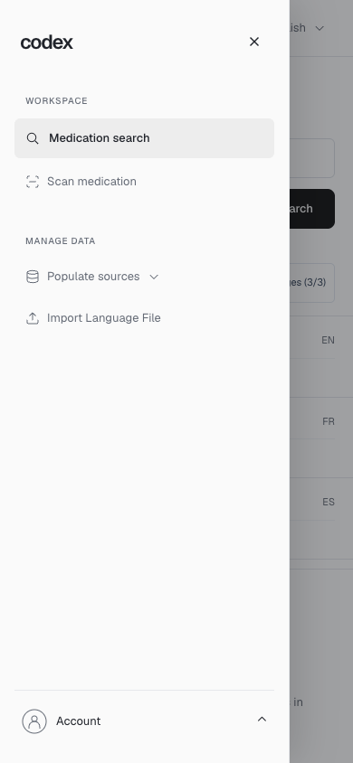

# Responsive Medical Codex workspace

Updated November 1, 2026. Integration branch: `codex/branden-stephen-integration`.

The workspace follows the [Purist design](https://purist.design/file/SprEvCZwabzDFdcZ).
The desktop layout keeps its 232px sidebar, 304px medication details column,
60px header and self-hosted Geist font. Smaller screens change the arrangement
of those components instead of shrinking the entire desktop screen.

This implements the shared [working sidebar task](https://app.notion.com/p/402815ddf30b80cc987fc7e09563cf5f)
and the [sidebar task that explicitly requires responsiveness](https://app.notion.com/p/402815ddf30b80098d72c170ed554fc4).
Stephen's separate [Render Left Hand Nav Bar task](https://app.notion.com/p/407815ddf30b807bac37da15ea8634d2)
can reuse the layout components described below. These links identify the source
requirements; they do not imply sponsor acceptance or completion of another
teammate's task.

## How the layout adapts

| Available space | Behavior |
| --- | --- |
| Viewport 1200px or wider | Sidebar, search/results and medication details sit beside one another. |
| Viewport 768px to 1199px | Sidebar narrows to 208px. Medication details move below the search/results area. |
| Viewport below 768px | Sidebar becomes a menu drawer. The page uses its full width for search, results and details. |
| Viewport below 480px | Medication input occupies its own row. Search language and the Search button share the next row. |
| Results area below 640px | Results become full-width selection cards. A tablet with a sidebar can use cards even when the viewport is wider than 640px. |
| Desktop viewport 600px high or shorter | Sidebar joins the page's normal scrolling flow so its lower controls remain reachable. |

CSS Grid uses `minmax(0, 1fr)` and content wrappers use `min-width: 0` so long
content cannot force the main column wider than the screen. A CSS container
query switches result cards to a table when the results area itself has enough
space. Wide tables use a fixed layout and wrap long medication and brand names.
This avoids using hidden page overflow to conceal content that does not fit.

When details are below the results, selecting a medication reveals a
"View medication details" link. It jumps to the selected details without
clearing the query, results or selection. The link is translated in all six
interface languages.

## Navigation, touch and dialogs

`WorkspaceLayout` uses the same sidebar component on desktop and mobile. Its
top navigation button collapses or expands the desktop sidebar, allowing the
workspace to fill the available width without resetting search or selection.
Below 768px the header instead shows a hamburger on the right, after the language
selector, which opens the existing navigation drawer. Tailwind responsive utilities
control the button's placement, sizing and appearance. The workspace combines
Tailwind 4 utilities with custom CSS for its grid, themes and container queries.
Desktop collapse state stays separate from the mobile drawer, including when resizing with an
open utility dialog.

Its JavaScript media query matches the CSS boundary at 767px. Opening the mobile
drawer locks page scrolling, makes the background inert and moves keyboard
focus into navigation. Tab stays inside the drawer. Escape closes an open
utility first, then navigation; closing navigation returns focus to its menu
button. Backdrop dismissal and viewport changes restore page scrolling.

Phone buttons and form controls have a minimum height of 44px. Menu and close
buttons are also at least 44px wide. Phone text inputs and selects use 16px text
to avoid the small-input focus zoom behavior in mobile Safari. The viewport
configuration keeps user zoom available.

Dialogs stay within the dynamic viewport height and scroll internally when
their contents are taller. Their headings can wrap without pushing the close
button off screen. Import filenames and long text wrap, filter actions can
move onto another line, and the import chooser supports Enter and Space.
Safe-area padding reserves room around device cutouts and the home indicator.
The existing reduced-motion preference and account appearance controls remain
available.

Desktop collapse animates the grid columns without remounting the workspace.
Menus and dialogs use short CSS opacity/transform transitions. Interface-language
changes fade text with the browser's Web Animations API, using opacity alone so
bottom-edge panels cannot briefly create page overflow. Reduced-motion mode
bypasses these effects. Wrapped navigation labels share a fixed icon column and
left-aligned text across English, Spanish, French, German, Russian and Ukrainian.

Search and translation use themed Radix Select popups with keyboard navigation,
typeahead and focus restoration. This is a UI dependency; no animation library
was added. Search loading uses skeleton rows. Invalid searches keep existing
results and associate guidance with the input; request failures offer a retry.
Shared dismissible toasts replace large error banners in the workspace tools.

## Component map

| File | Responsibility |
| --- | --- |
| `frontend/src/components/layout/WorkspaceLayout.tsx` | Drawer state, focus handling, inert background and scroll restoration. |
| `frontend/src/components/layout/Header.tsx` | Header, breadcrumbs and responsive navigation toggle. |
| `frontend/src/components/layout/LeftNavBar.tsx` | Shared sidebar content: search, OCR, source population, import and account controls. |
| `frontend/src/components/layout/WorkspaceTools.tsx` | Shared tool callbacks and the results language-filter control. |
| `frontend/src/components/account/LoginModal.tsx` | Sign-in trigger, validated credentials and the server-token login flow. |
| `frontend/src/index.css` | Grid layout, media/container queries, touch sizing and safe areas. |
| `frontend/src/components/results/ResultsTable.tsx` | Table/cards, selection and link to details. |
| `frontend/src/components/ui/Modal.tsx` | Viewport-bounded dialogs, wrapping headings and close control. |
| `frontend/src/components/import/ImportLanguageModal.tsx` | File selection, keyboard chooser, validation and upload controls. |
| `frontend/tests/browser/responsive.spec.ts` | Boundary widths, long content, phone targets, landscape and localized/dark layouts. |

To reuse the sidebar, render `WorkspaceLayout` around the page content and
pass its existing import/search callbacks and language list. Keep the CSS and
JavaScript drawer breakpoints together. Do not add a second mobile sidebar
with a separate copy of the search or account state.

## Verification

The November 1 verification passed 42 browser scenarios across the full run and
targeted reruns. These include desktop collapse, search/selection preservation,
focus during viewport changes, mocked server-token sign-in and sign-out, language
refresh after importing, Russian and Ukrainian dialogs, translated-label
alignment, scrollbar stability, custom picker keyboard access, retries and toasts.
The population-stream suite passed its 17 unit tests. Lint and the production
TypeScript/Vite build also passed. Three backend metadata/access checks and live
requests for all 10 Russian and 18 Ukrainian bundled translation entries passed.

The browser suite checks 320, 360, 390, 479, 480, 639, 640, 767, 768, 1024,
1199, 1200 and 1440px widths. It also checks a 667 by 320 landscape viewport,
touch-enabled phone emulation, long medication/brand names, a long import
filename, German interface labels and dark appearance. Existing regression
checks cover search, filtering, translation, keyboard navigation, account
controls, upload error handling and changes between mobile and desktop.

Run the checks from `frontend/`:

```sh
npm test
npm run lint
npm run build
npm run test:ui
```

Screenshots use synthetic test records:





These checks exercise Chromium with intercepted API responses. They do not
verify live Neo4j data, OCR accuracy, real account credentials, an on-screen
keyboard or a physical iPhone/Android device. Physical-device Safari testing
is still useful for checking keyboard and safe-area behavior.

## Branch integration and testing on a phone

The October 31 integration combines `branden-branch` at `fc81def` with the UI
commits from Stephen's `stephen-nav-bar-ui-branch` at `4afd2de`. Five feature
commits were cherry-picked with their original author information. Stephen's
branch also includes other developers' backend changes; those were excluded
from this frontend integration.

The overlapping sidebars are reconciled in `LeftNavBar`. `WorkspaceLayout`
owns its placement and drawer/collapse behavior. Tools use the existing search
and import callbacks. The interface-language selector stays in the header and
the results filter stays beside the results, so each has one control and one
shared state. Geist, themes, embedded documentation and the right-hand phone
hamburger remain available.

Stephen's `LoginButton` now uses Ryan's `/auth` request, requires a
server access token, and updates the account menu through `onSuccess`. The
separate `SignIn` component was consolidated into it. The source branch's
region and social buttons had no destinations or handlers. The sign-in dialog footer now
uses the website, X and Facebook destinations published by Grey-box's official
website. Help includes a small themed SVG illustration, and the home breadcrumb
shows only Medications.

The frontend was brought over from
[`9337574`](https://github.com/grey-box/Project_Codex/commit/9337574702907a1cb95c2a2120279d56e849da89)
onto the existing `branden-branch`, then extended with the responsive changes
above. The branch's backend/authentication code, backend tests and ACL research
were retained. No backend access rule was relaxed. The integration includes the
source frontend's Tailwind build setup and browser-test tooling. The responsive
adjustments use native motion and inline SVG artwork. The custom select adds
Radix UI; it is separate from the animation implementation.

For a phone on the same network, start Vite with `npm run dev -- --host 0.0.0.0`
and open the development computer's LAN address on port 9000. For real API
requests through Vite, set `VITE_API_BASE_URL=/backend` in an ignored local
environment file and restart Vite. Its development proxy targets
`http://127.0.0.1:8000` by default, so the phone uses the frontend origin rather
than its own localhost. Override `CODEX_API_PROXY_TARGET` when the API runs
elsewhere; a containerized frontend uses `http://api:8000`. A production build
needs its deployment's explicit API URL or reverse proxy. Direct browser-to-API
requests still require the exact frontend origin in backend CORS settings.

The branch's API supports the existing search, translation, language-pack and
login contracts. Its entry point does not yet expose `/ocrmatching/`; connecting
that interface requires the team's OCR backend integration. The spreadsheet
drug-list feature is a separate Notion task and is not implemented by this
responsive layout work.

See [the backend and branch audit](research/backend-branch-audit.md) for the
remaining provider-ingestion, authentication and search-metadata limitations.
